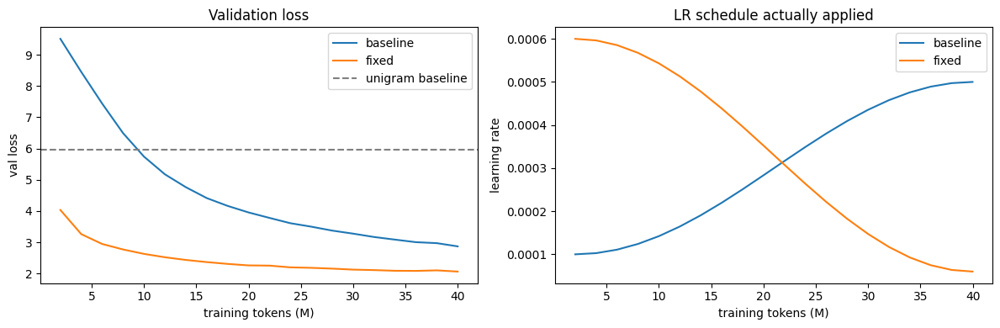

# Training-setup ablation: a 30M-param GPT-style LM on TinyStories

A controlled experiment that measures how much a broken training setup costs a small language model, and what fixing it buys. The results are benchmarked against [roneneldan/TinyStories-33M](https://huggingface.co/roneneldan/TinyStories-33M), the reference model released with the TinyStories paper ([Eldan & Li, 2023](https://arxiv.org/abs/2305.07759)).

**Reference model:** [TinyStories-33M](https://huggingface.co/roneneldan/TinyStories-33M) (GPT-Neo: 4 layers, hidden size 768, 16 heads, trained at context 512 with a constant LR of 5e-4). It's scored on the same validation tokens with the same protocol as my runs (see [Evaluation](#evaluation)).

**Starting point:** a common nanoGPT-style GPT-2 training setup for TinyStories (code style from [karpathy/nanoGPT](https://github.com/karpathy/nanoGPT)). Evaluating that setup turned up two training bugs:

1. **The LR schedule rose instead of decaying.** `min_lr` (5e-4) was set above the peak `learning_rate` (1e-4), so cosine "decay" climbed all run.
2. **Too few real updates.** The scheduler stepped every micro-batch, and with gradient accumulation of 32 the model got only ~300 optimizer updates.

## Experiment

Same model (30.0M params: 6 layers, 6 heads, d=384, context 128), same data, same seed, same GPU (Colab T4, fp16), and **the same 40M training tokens**. Only the training setup differs.

| | baseline (original setup) | fixed |
|---|---|---|
| learning rate | 1e-4 → *rising to* 5e-4 | 6e-4 → decaying to 6e-5 |
| scheduler steps on | every micro-batch | every optimizer update |
| grad accumulation | 32 | 4 |
| optimizer updates | 305 | 2,441 |

Both runs also share hygiene fixes: grads unscaled before clipping (fp16), and `model.eval()` for generation.

## Evaluation

- **Metric:** cross-entropy and perplexity on the **entire** TinyStories validation split (4.74M tokens, never trained on). It's evaluated in non-overlapping 128-token windows, so the number is deterministic.
- **Floor:** a context-free unigram model (token frequencies, add-one smoothed).
- **Ceiling:** [TinyStories-33M](https://huggingface.co/roneneldan/TinyStories-33M), scored by `eval_tinystories33m.py` on the identical token stream. Its tokenizer gives the same ids as tiktoken `gpt2` (checked on 200 stories), so per-token perplexities compare directly.
- **Qualitative:** fixed-seed samples from the same prompts (temperature 0.8, top-k 50).

## Results

| run | params (total / non-embedding) | training | val loss | perplexity |
|---|---:|---|---:|---:|
| unigram baseline | – | – | 5.965 | 389.6 |
| baseline | 30.0M / 10.7M | 40M tokens, 305 updates | 2.882 | 17.84 |
| **fixed** | 30.0M / 10.7M | 40M tokens, 2,441 updates | **2.077** | **7.98** |
| TinyStories-33M (reference) | 68.5M / 28.3M | full TinyStories, token budget not published | 1.638 | 5.15 |

- Validation perplexity fell **55%** (17.84 → 7.98) at the same token budget.
- The fixed run hit the baseline's *final* loss after ~6–7M tokens, roughly a sixth of the data.
- Train and val loss track each other in both runs: no overfitting, and the fixed model is still improving at 40M tokens.
- **Against the reference:** fixing the setup closed about two-thirds of the gap. The baseline sat 1.24 nats above TinyStories-33M and the fixed run sits 0.44 above (perplexity 7.98 vs 5.15). TinyStories-33M has ~2.7x the non-embedding parameters and a much larger training budget, so treat it as a ceiling, not an equal-budget comparison.
- Samples (prompt "Tom was sad because"): the baseline swaps characters mid-story ("a big, excited boy named Lily… Max's mommy came"), while the fixed model keeps Tom, Sam and the red ball consistent throughout. TinyStories-33M is more fluent, but it drifts too: Tom hides, then "Lily went to look for Tom… 'Where are Tom?'"

**Caveats on the reference row:** it's scored at 128 tokens of context (it supports 2,048), on a stream with no separators between stories, to match how my models were evaluated. Both choices likely lower its score, so 5.15 is a conservative ceiling.

## Reproduce

Open `slm_training_eval.ipynb` in Colab with a T4 GPU and Run all. Set `SMOKE = True` first for a ~2-minute end-to-end check. Results, checkpoints and plots are written to `MyDrive/slm_eval/`. A finished run is skipped on re-run. Two 40M-token runs take about 35 minutes on a T4.

`training_log.txt` is the raw log from the run reported above.

Reference row: `pip install torch transformers datasets tiktoken && python eval_tinystories33m.py` (CUDA, Apple MPS or CPU). It writes `tinystories33m_results.json` with the loss, parameter counts and samples.

## Next

- Train past 40M tokens: the fixed curve hasn't flattened, and the 0.44-nat gap to TinyStories-33M shows how much headroom is left.
- Measure coherence directly (character/entity consistency, repetition rate, or an LLM grader as in the TinyStories paper), since perplexity alone doesn't tell you a story makes sense.
